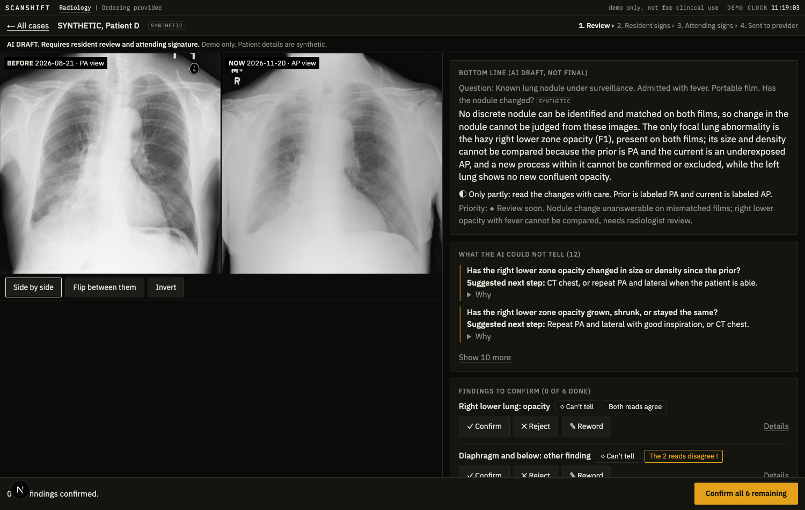
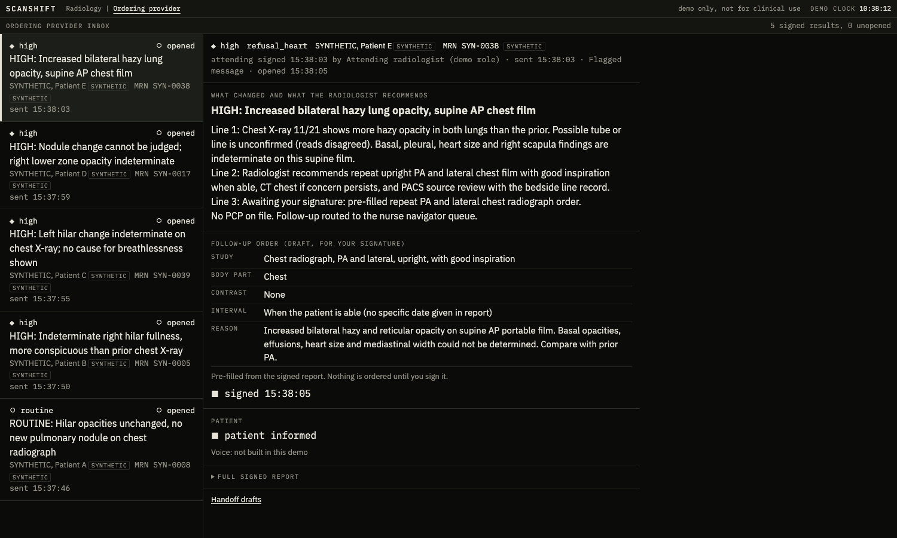
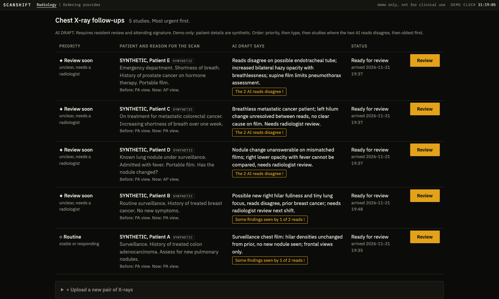

# ScanShift

Claude Impact Lab NYC, Track 3 (Radiology / Oncology). Demo build. Not
for clinical use.

**Who it is for:** the radiologist reading a cancer patient's follow-up
chest film.

**The problem:** they write the comparison with the prior study from
scratch, and some image pairs cannot support a call.

**What it does:** compares the prior and current image and drafts a
structured first read: what changed, what did not, what to look at first,
and what it declines to call. A resident reviews it and an attending
signs it. Only then does the result go to the ordering provider.

## Safety design

- The reason for the scan is hidden from the blind reads.
- The blind read runs twice. The app shows agreement between the reads,
  not a model-reported confidence.
- The model gives no measurements. A radiologist enters them and code
  does the RECIST arithmetic.
- "Can't determine" is a first-class output with a reason and a next step.
- Nothing leaves radiology before the attending signs.

## Data

Public de-identified images from NIH ChestX-ray14. All chart data is
synthetic and labelled synthetic. Testing so far is a smoke test on a
small number of pairs, not a validation study.

Chest X-ray images: NIH Clinical Center, ChestX-ray14.
https://nihcc.app.box.com/v/ChestXray-NIHCC. Wang X, Peng Y, Lu L, Lu Z,
Bagheri M, Summers RM. ChestX-ray8: Hospital-scale Chest X-ray Database
and Benchmarks on Weakly-Supervised Classification and Localization of
Common Thorax Diseases. IEEE CVPR 2017, pp. 3462-3471.

## Screens







## Try it

**In a browser, nothing to install.** `index.html` is a static snapshot of the five recorded example
cases. Review, reject with a reason, and both signatures work in the page. "Compare your own pair"
shows two of your images side by side (they never leave the browser, and no AI reads them there).

**The app, no API key needed.** Needs Node 22.

```
npm install
npm run demo         # builds, then serves recorded model responses at http://localhost:3000
```

Open a case and follow the one highlighted button: **Confirm all remaining**, **Sign as resident**,
**Sign as attending**, then **See what the provider received**. Every model response on that path was
recorded from a real run and is replayed. **Start over** returns a case to its unreviewed AI draft. Editing or rejecting a
finding changes what the report writer is asked, so that path needs a key.

**The app, live.** Put `ANTHROPIC_API_KEY=...` in `.env.local` (server side only, gitignored).

```
npm run dev                    # http://localhost:3000. Model ids are checked at start
npm run models                 # checks the ids in src/lib/config.ts against the key
npm run pipeline -- new_nodule # one case from upload to report draft, without the browser
npm run cases                  # scorecard.md from the stored runs (add -- --rerun to run them again)
npm run check                  # typecheck, unit tests, rule guard
```

## Upload your own pair

On the worklist, open **Upload a pair**. Choose a prior and a current chest film (JPEG, PNG or WebP,
checked by the file's first bytes), set each view (PA or AP), and type the reason for the scan.
Uploading starts the two blind reads. The reason is held on the server until both are saved.
Use public, de-identified images only. Uploaded images are gitignored. Needs a key.

## Example cases

Five pairs from NIH ChestX-ray14, in `data/cases/`, each with its images, a synthetic chart, the
recorded AI draft (`state.json`, `baseline.json`) and blank `ground_truth` for a clinician to fill.

| Case | Films | Why it was picked |
|---|---|---|
| `new_nodule` | PA then PA | NIH label goes from No Finding to Nodule. The reads called the dense hilar foci stable |
| `control` | PA then PA | No Finding on both. Any called change is a false flag to look at |
| `new_effusion` | PA then PA | Effusion label added on the current film |
| `refusal_nodule` | PA then AP | Declines to say whether the right lower zone opacity changed. Next step: CT chest |
| `refusal_heart` | PA then AP | Declines to say whether the heart size changed. Next step: repeat PA and lateral |

NIH labels are text-mined and noisy. They are hints for choosing cases and are never sent to a model.

## Layout

- agents/: reading method and the four agent specs (the app loads its prompts from here)
- dataset/: dataset guide, pair manifest, pull script
- data/cases/: one folder per case, with its two films. data/cache/: recorded model responses
- docs/screenshots/: the pictures above
- src/lib/: pipeline code and tests. src/app/: screens and API routes
- scripts/: command line runners
- fixtures/: mock UI fixture
- CLAUDE.md, .claude/: project rules, hooks and subagents for Claude Code
- BUILD_PROMPT.md: build instructions
